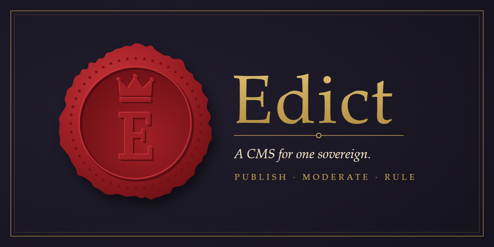

# Edict

A small, opinionated, single-author CMS for self-hosted websites (Apache on NetBSD).

One sovereign publishes; everyone else reads, votes and comments, at the sovereign's pleasure.

**Status:** concept phase. The concept, feature list and implementation slices will be tracked in this repo's issues and in `docs/`.

## Planned at a glance

- Full-screen WYSIWYG article editor
- File attachments with type-aware rendering (inline audio and video players, images sized to fit the article that open full-size on click, downloads)
- Reader votes and comments, with full moderation control: one-click removal and adjustable vote counts
- Single-admin authentication
- RSS/Atom feed and other extras (see the concept doc)
